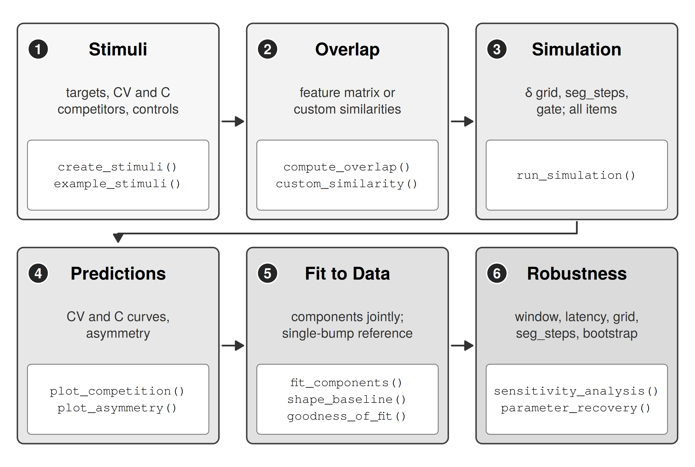

# phonActivR 

[](https://opensource.org/licenses/MIT)
[](https://cran.r-project.org/)
[](https://github.com/yclinpsy/phonActivR/actions/workflows/R-CMD-check.yaml)

**An R package for simulating and fitting prosodic constraints on lexical competition in spoken word recognition**

## Authors

- **Yu-Cheng Lin** — Department of Psychological Science, University of Texas Rio Grande Valley
- **Hitomi Kambara** — Department of Bilingual and Literacy Studies, University of Texas Rio Grande Valley

## Overview

`phonActivR` is a pure-R package that implements a compact lateral-inhibition competition model in the interactive-activation family (not TRACE; see the DESCRIPTION and the tutorial's Table 1 for what is omitted). It provides an architecture for generating predictions about phonological competition in spoken word recognition. It requires no Java or external software.

### Key Features

- **δ (delta) parameter**: Operationalizes cross-linguistic prosodic processing constraints (e.g., moraic, syllabic) as a gate on the input of competitors that match the target only below the prosodic unit. The gate can delay that input (`gate = "delay"`, default) or truncate it (`gate = "truncate"`).
- **Disambiguation point**: each competitor receives input only while the segments it shares with the target unfold, so competition rises and resolves; `residual_input` optionally extends support by one segment, and `c_weight` sets the strength of consonant-only (C) input.
- **Item-level simulation**: Runs across full experimental stimulus sets (not just single words), with automatic phonological overlap computation from a binary adaptation, constructed by the package authors, of the seven McClelland–Elman (1986) feature dimensions (a similarity metric only; see `?trace_features` for its resolution limits), or from user-supplied similarities.
- **Fitting to real data**: `fit_components()` fits the CV and C competition curves jointly (least-squares scale, estimated response latency); `goodness_of_fit()` fits the CV−C asymmetry; `shape_baseline()` gives a single-Gaussian reference; `bootstrap_delta()` refits on participant resamples and reports the distribution of the selected delta. R² and AIC are reported; ΔAIC is a ranking only.
- **Checks before interpreting δ**: robustness to window, latency range, δ grid, and segment duration; parameter recovery by either estimator and under misspecified data (`parameter_recovery(method =, generate_with =)`); distinguishability across parameters (`sensitivity_analysis()`).
- **Real data**: mouse-tracking data for the bundled 42 English items (Lin et al., 2023): group means (`lin2023_english`) and de-identified item- and participant-level mean trajectories (`inst/extdata/lin2023_validation/`); and for the same bilinguals listening to Mandarin (`lin2023_chinese`, 24 items, `example_stimuli_zh()`).
- **Publication-ready figures**: All visualizations are ggplot2 objects, customizable with standard ggplot2 grammar.

## Installation

```r
# Install from GitHub (build_vignettes = TRUE makes the tutorial vignette
# available via vignette("phonActivR-tutorial"))
install.packages("devtools")
devtools::install_github("yclinpsy/phonActivR@v0.3.0", build_vignettes = TRUE)
```

No Java, Python, or external software required. Help pages for every
exported function are available in the usual way (e.g., `?run_simulation`,
`?custom_similarity`).

## Quick Start

```r
library(phonActivR)
stim <- example_stimuli()              # built-in 42-item stimulus set
sim  <- run_simulation(stim, delta_values = seq(0, 30, 5))  # fine grid for fitting
plot_asymmetry(sim)                    # delta curve families
fit_components(sim, lin2023_english)   # CV and C fitted jointly (Lin et al., 2023)
shape_baseline(lin2023_english)        # single-bump reference
goodness_of_fit(sim, lin2023_english)  # asymmetry fit
overlay_empirical(sim, lin2023_english, show_pre_onset = TRUE)
```

Before interpreting delta, vary the input settings (`c_weight`, `residual_input`) and compare `fit_components(..., shared_scale = FALSE)`; `fit_components()` warns (and sets `attr(x, "c_fit_ok")` to `FALSE`) when the C component is poorly fitted at the selected delta.

## Tutorial

A comprehensive step-by-step tutorial is available as a package vignette:

```r
vignette("phonActivR-tutorial")
```

The tutorial demonstrates the complete workflow from stimulus specification through simulation, visualization, and empirical comparison, illustrated with real mouse-tracking data for the bundled stimuli (Lin et al., 2023), including the robustness checks needed before interpreting a best-fitting delta.

## Reproducing Paper Figures

All figures and numbers in the accompanying *Behavior Research Methods* tutorial paper are reproduced by four scripts in `inst/extdata/`:

```r
ext <- system.file("extdata", package = "phonActivR")
source(file.path(ext, "generate_figures.R"))  # all 11 figures, Figures S1-S3; Tables 4, 5, 7, S3
# lin2023_validation/validation.R             # Step 6b checks; Tables 6, 7, S1, S4; Supplement S2, S5
# linking_tests/linking_tests.R               # linking-function tests (Supplement S2.1)
# trace_correspondence/correspondence_analysis.R  # Validation 1; Supplement Table S2
```

`validation.R` reads its input files from, and writes its CSV output to, the working directory, so copy its folder somewhere writable first:

```r
file.copy(file.path(ext, "lin2023_validation"), ".", recursive = TRUE)
setwd("lin2023_validation"); source("validation.R")   # about 40-60 minutes
```

The simulation is deterministic. Package functions that add noise use local seeds, and the scripts that resample items or participants set fixed seeds, so results are reproduced exactly. The `figures/` folder shown in this README is in the GitHub repository but excluded from the package tarball.

## Functions

Complete inventory of the exported functions (see each function's help page,
e.g. `?run_simulation`, for details):

| Function | Purpose |
|----------|---------|
| `trace_features()` | Binary adaptation of the McClelland–Elman (1986) feature dimensions (similarity metric only; see `?trace_features`) |
| `phoneme_similarity()` | Feature-based (or custom) phoneme-pair similarity |
| `custom_similarity()` | Build a similarity lookup from user-entered pairwise values (cross-linguistic use) |
| `check_phoneme_coverage()` | Report stimulus phonemes and compared pairs not covered by the active feature/similarity set |
| `compute_overlap()` | Word-level phonological overlap (C, CV, CVC, syllable) |
| `shared_segments()` | Number of segments a competitor type shares with the target (sets its disambiguation point) |
| `run_activation()` | Single competitor–control pair activation dynamics |
| `run_item()` | Single-item two-condition (larger/smaller grain) simulation |
| `find_onset()` | Competition-onset detection on an effect curve |
| `create_stimuli()` | Organize stimulus sets with transcriptions of the initial segments |
| `run_simulation()` | Run the model across items and δ values (`seg_steps`, `gate`, `residual_input`, `c_weight`) |
| `plot_competition()` | Competition effect curves for competing hypotheses |
| `plot_asymmetry()` | CV–C asymmetry gradient across δ |
| `plot_onset_timing()` | Predicted competition onset as a function of δ |
| `theme_phonactivr()` | Publication ggplot2 theme shared by all package figures |
| `phonactivr_colors()` | Colorblind-safe Okabe–Ito categorical palette |
| `fit_components()` | Fit the CV and C curves jointly (primary estimator of δ); `shared_scale = FALSE` fits each with its own scale |
| `goodness_of_fit()` | Fit every δ model to the CV−C asymmetry (least-squares scale, latency via `lag`, R², AIC; group-aware; `time_window`) |
| `shape_baseline()` | Single-Gaussian reference fit (R², AIC) |
| `bootstrap_delta()` | Refit every δ model on participant resamples and report the distribution of the selected δ |
| `overlay_empirical()` | Draw empirical data onto the δ curves at the scale and latency of the selected model |
| `example_stimuli()` | Built-in 42-item English stimulus set of Lin et al. (2023); `example_stimuli_jp()` is the same function under its earlier name |
| `example_stimuli_zh()` | Built-in 24-item Mandarin set (Lin et al., 2023, Exp. 1); use with `mandarin_similarity()` |
| `mandarin_similarity()` | Illustrative similarity table for the Mandarin set's Pinyin-based codes |
| `example_empirical()` | Synthetic CV, C, and asymmetry curves from the model at a chosen δ (optionally from a different model via `generate_with`) |
| `lin2023_english` (data) | Real mouse-tracking competition curves from Lin et al. (2023), Exps 3–4, for the same 42 items |
| `lin2023_chinese` (data) | The same for Exp. 1: Chinese–English bilinguals listening to the 24 Mandarin items |
| `export_results()` | Save simulation output and every setting needed to re-run it |
| `power_guidance()` | Screening heuristic for separating adjacent δ values (not a power analysis; supply a model-to-data `scale`) |
| `sensitivity_analysis()` | Distinguishability of δ values across parameter combinations |
| `parameter_recovery()` | Recover a known δ from synthetic data, by either estimator, optionally under misspecification |
| `cohort_rhyme_benchmark()` | Qualitative cohort/rhyme benchmark |
| `compare_languages()` | Side-by-side comparison of two simulations (two groups or two model variants) |

## Citation

If you use phonActivR in your research, please cite:

> Lin, Y.-C., & Kambara, H. (2026). *phonActivR: Simulating and fitting prosodic constraints on lexical competition in spoken word recognition* (R package version 0.3.0) [Computer software]. https://github.com/yclinpsy/phonActivR

A tutorial article describing the package is under review at *Behavior Research Methods*; this section will be updated when it is published. `citation("phonActivR")` gives the same reference.

## Related Package

[**phonSizeR**](https://github.com/yclinpsy/phonSizeR) — A companion package that computes a continuous, descriptive grain-size index (φ) directly from empirical competition data, with bootstrap confidence intervals and permutation group tests. While phonActivR generates predictions (forward simulation), phonSizeR summarizes observed data.

**Recommended workflow**: phonActivR for exploratory simulation and hypothesis generation → phonSizeR for quantitative description of the observed data.

## License

MIT License © 2026 Yu-Cheng Lin and Hitomi Kambara
